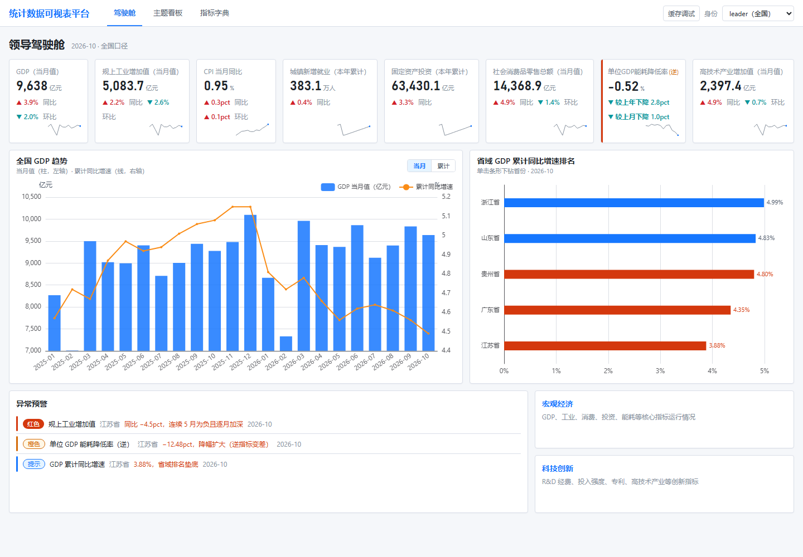
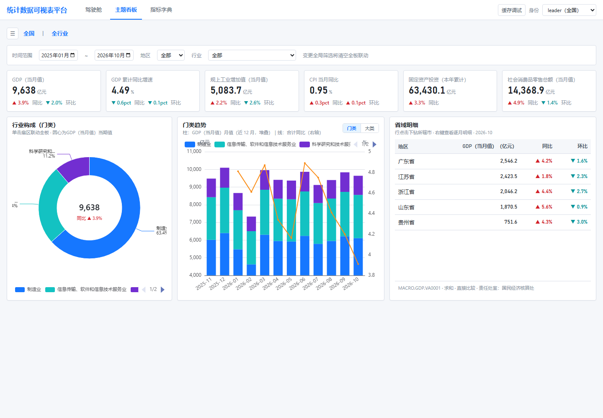
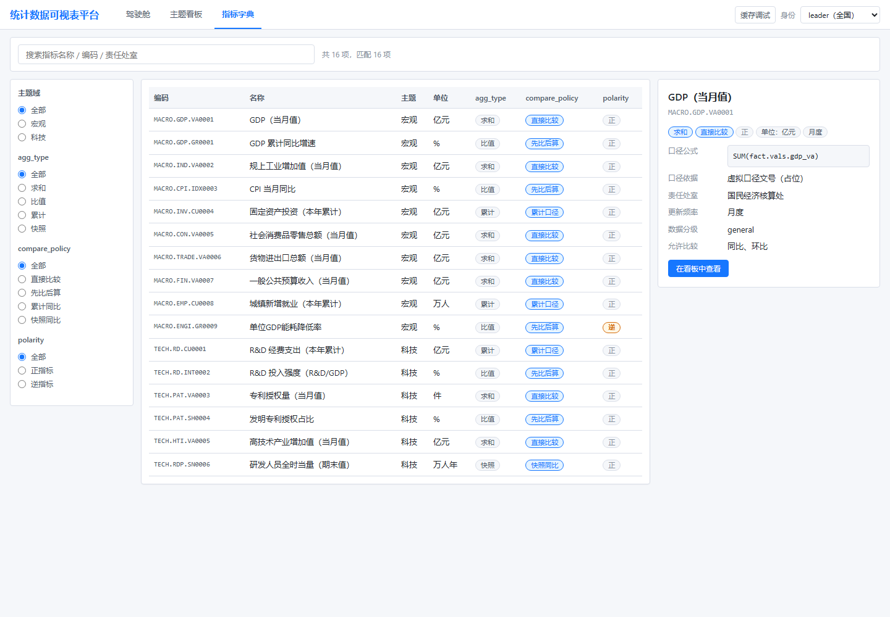
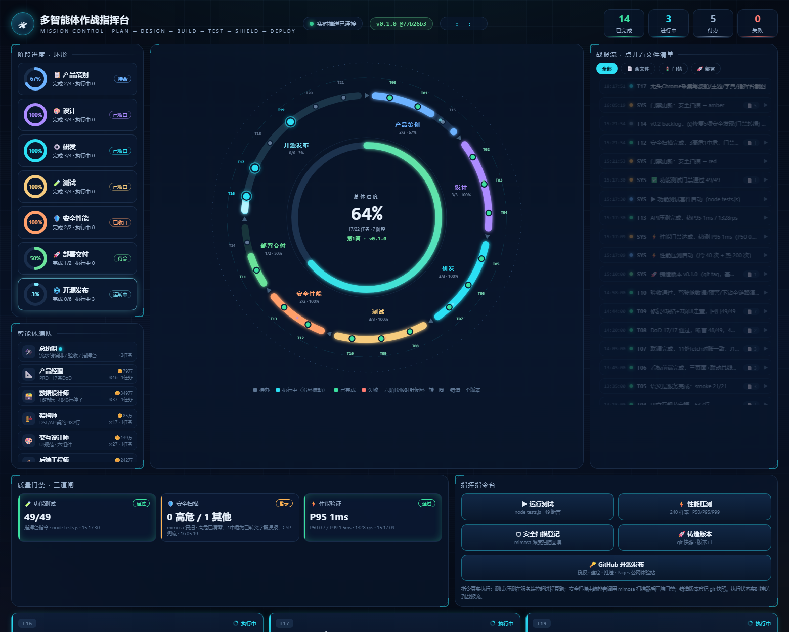
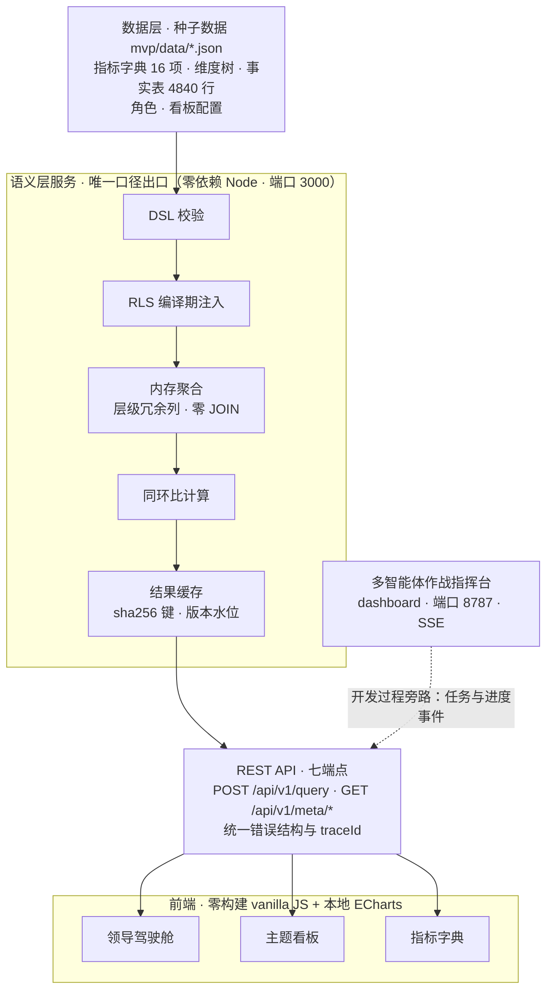

<div align="center">

# StatVista


**指标先行的统计数据多维可视表平台：统一口径、多维下钻、联动分析与领导驾驶舱。**

*A metric-first multidimensional visual analytics platform for official statistics:
unified metric definitions, multidimensional drill-down, linked analysis, and an executive cockpit.*

统计场景 MVP 技术验证原型 · 零依赖 · 离线可演示

</div>

---

## 📸 界面速览

| 领导驾驶舱 | 主题看板 · 行业构成联动 |
|---|---|
|  |  |
| **指标字典** | **多智能体作战指挥台** |
|  |  |

> 领导驾驶舱：8 指标卡 + GDP 双轴趋势 + 省域排名（垫底标红）+ 异常预警；
> 主题看板：同一模板换参数渲染，环形图单击全板联动；指标字典：16 指标全字段检索与口径详情；
> 作战指挥台：本项目由多智能体协同构建，`dashboard/` 是它们的实时任务看板（SSE）。

---

## ✨ 背景与动机

2023 年 10 月国家数据局正式挂牌，「数据要素×」三年行动计划圈定 12 个重点领域，全国一体化政务大数据体系按「1+32」框架推进。数据有了，但**统计数据的消费体验**仍是老大难：

- **口径不一**：同一个指标，各部门各说各话，「同名不同义」让跨部门对数变成体力活；
- **指标烟囱**：每个主题库自带一套报表，重复建设、互不相通；
- **取数慢**：一次临时统计需求要走需求排期，数据分析师被 SQL 工单淹没。

与此同时，《数据安全法》、等保三级与信创合规划定了硬边界：数据不出省、权限必须收口、链路必须国产化友好。

**StatVista 是对这些问题的回答**：一个「指标先行」的统计数据多维可视表平台 MVP 技术验证原型。它用最小成本验证一条路线——先统一指标口径，再谈可视化与下钻联动；语义层作为唯一取数出口，权限与缓存编译期收口。总体设计见 [`docs/统计数据可视表平台设计方案.md`](docs/统计数据可视表平台设计方案.md)（v1.0，四智能体调研 + 红队评审 17 项挑战定稿）。

---

## 💡 核心思路

| 理念 | 一句话 | 实现说明 |
|---|---|---|
| **① 指标先行** | 每个指标有唯一编码、口径与责任人，图表只引用、不写 SQL | 指标如 `MACRO.GDP.VA0001`，口径公式/分子分母引用/责任处室全部入库，语义层拒绝未注册指标 |
| **② 一切皆 JSON** | 看板与大屏是 JSON 配置，可版本化、下发、回滚 | 看板配置存于 `data/dashboards.json`，服务端原样下发，前端同一模板换参数渲染 |
| **③ 语义层唯一出口** | 所有查询必经语义层编译，权限/脱敏/缓存编译期收口 | DSL → SQL 编译流水线，RLS 按角色注入谓词，前端永不参与安全、不许直连数据 |

---

## 🧩 功能特性

| 特性 | 说明 |
|---|---|
| 指标字典 | 16 个指标全字段检索：唯一编码、口径公式、责任处室、聚合类型、比较策略、极性（含逆指标警示） |
| 领导驾驶舱 | 8 指标卡 + GDP 当月柱/累计同比线双轴 + 省域增速排名（垫底标红）+ 3 组预埋异常预警 |
| 主题看板 | 看板即 JSON：全局筛选带（时间/地区/行业）、行业构成环形图单击联动、明细表行下钻与右键逐月明细 |
| 多维下钻 | 全国 → 省 → 市、门类 → 大类逐级下钻；层级冗余列设计，**零 JOIN**；URL 即终态，复制新标签完整还原 |
| 双轨联动 | 全局筛选单例（改时间全板刷新）+ 图表级事件总线（同维过滤 last-wins 消解，可精确控制只联动 A 不联动 B） |
| 三角色 RLS | `leader` / `prov-js` / `prov-gd` 请求头编译期注入；越权查询返回 200 空集而非报错 |
| 同环比策略 | 由指标元数据声明（`agg_type` + `compare_policy`），语义层独占计算：比值先比子项再算比值，累计指标禁环比 |
| 版本水位缓存 | 缓存键 = sha256(角色 × 规范化 DSL × 数据水位 × 字典版本)；`POST /api/v1/admin/watermark` 即时失效 |
| 语义层七端点 | 查询、指标字典、维度树、看板配置、缓存水位等七端点，错误结构与状态码全契约化 |
| 作战指挥台 | `dashboard/` 多智能体指挥台（端口 8787，SSE 实时推送），记录本项目「AI 军团」的构建过程 |

---

## 🏗️ 系统架构



**五大设计决策**（完整论证见设计方案 §0）：

| # | 决策 | 一句话理由 |
|---|---|---|
| 1 | 分层混合自研：语义层自研 + 渲染层用开源 | 口径与下钻联动是核心资产，通用 BI 反而是包袱 |
| 2 | 事实表冗余层级列，下钻零 JOIN | 每次下钻退化为「换 group by 列 + 等值过滤」，亚秒可达 |
| 3 | 元数据集中 + 数据联邦 | 数据不出省是政务底线，口径不失控是平台底线 |
| 4 | 全局筛选 + 事件总线双轨联动 | 既保「改时间全板刷新」，又保「只联动 A 不联动 B」 |
| 5 | 同环比策略由指标元数据声明 | 比值先比子项再算比值、累计禁环比——这是最容易出错的地方 |

---

## 🚀 快速开始

环境要求：**Node ≥ 18**（仅用内置模块，无 npm install、无构建、无 CDN）。

```bash
git clone https://github.com/<your-org>/statvista.git
cd statvista
node mvp/server/index.js        # 默认端口 3000，可带参数指定（如 node mvp/server/index.js 3001）
```

启动后浏览器打开 `http://127.0.0.1:3000`，三个页面（URL 即终态，哈希路由）：

| 页面 | 地址 | 看点 |
|---|---|---|
| 领导驾驶舱 | `http://127.0.0.1:3000/#/cockpit` | 8 指标卡 + GDP 趋势 + 省域排名 + 异常预警 |
| 主题看板 | `http://127.0.0.1:3000/#/theme/macro` | 全局筛选、行业构成环形图单击联动、明细表下钻（`#/theme/tech` 同模板） |
| 指标字典 | `http://127.0.0.1:3000/#/dict` | 16 指标检索、口径公式、逆指标警示 |

**角色切换（RLS 演示）**：页面右上角「身份」切换器，切换后同 URL 自动裁剪为对应口径：

| 角色 | 口径 |
|---|---|
| `leader` | 全国：5 省排名、全量维度树 |
| `prov-js` | 江苏：指标卡=本省、排名=本省 4 市、维度树仅本省子树 |
| `prov-gd` | 广东：同上；与 prov-js 同 DSL 命中不同缓存条目 |

越权体验：以 `prov-js` 显式查询广东 → 返回 200 空集（行级安全语义，不报错）。

**演示亮点 J1 · 领导旅程五步**（约 5 分钟，API 级验证记录见 `mvp/README.md` §4）：

1. **全国总览**：驾驶舱默认最新月，GDP 当月值与累计同比一屏尽收；
2. **发现异常**：省域排名江苏垫底标红，预警行同步提示（零点击，悬停即现）；
3. **下钻定位**：单击江苏条形 → 跳转主题看板，面包屑「全国 › 江苏」，4 市排名呈现；
4. **联动分析**：单击行业构成环形图「制造业」扇区 → 全板切换制造业口径；
5. **明细取证**：右键查看逐月明细，同比连续 5 月为负且逐月加深，表底自动附口径脚注。

curl 调试示例：

```bash
curl -s -X POST http://127.0.0.1:3000/api/v1/query \
  -H "Content-Type: application/json" -H "X-Role: leader" \
  --data-binary '{"metrics":["MACRO.GDP.VA0001"],"dimensions":[{"dim":"region","granularity":"province"}],"time":{"grain":"month","range":["2026-10","2026-10"],"compare":["yoy"]}}'
```

自检命令：`node mvp/server/tests.js`（49 条自动断言）与 `node mvp/server/smoke.js`（冒烟）。

---

## 🌐 在线体验

**公网体验站已上线**：<https://topbat.github.io/statvista/demo/>
（GitHub Pages 从 `main` 分支 `/docs` 自动部署，每次推送自动更新；落地页含截图与导航。）

版本发布与打包产物见 [Releases](https://github.com/topbat/statvista/releases)：打 `v*` 标签自动跑全量测试 → 打包体验站 zip → 创建 Release 并附资产。

---

## 📁 目录结构

```
statvista/
├── README.md                            # 本文件
├── CHANGELOG.md                         # 版本变更记录
├── LICENSE                              # Apache-2.0
├── docs/
│   ├── 统计数据可视表平台设计方案.md      # v1.0 总体设计方案（生产架构蓝本）
│   ├── screenshots/                     # 运行截图（本 README 引用）
│   └── mvp/                             # MVP 文档 01～08（见「文档索引」）
├── mvp/
│   ├── server/
│   │   ├── index.js                     # 语义层服务：DSL 校验→RLS→聚合→同环比→缓存 + 静态服务
│   │   ├── tests.js                     # DoD 逐项测试套件（49 条自动断言，零依赖）
│   │   └── smoke.js                     # 冒烟自测（随机端口自启自停）
│   ├── web/
│   │   ├── index.html / app.js / style.css   # 零构建单页前端
│   │   └── assets/echarts.min.js        # 本地化 ECharts（离线可用）
│   ├── data/                            # 指标/维度/事实/角色/看板 五个 JSON（4840 行种子）
│   └── tools/gen-facts.js               # 确定性种子数据生成器
└── dashboard/                           # 多智能体作战指挥台（端口 8787，SSE）
```

---

## 🛠️ 技术选型

| 层 | 原型选型（本仓库） | 生产栈规划（见设计方案） |
|---|---|---|
| 语义层 | 零依赖 Node 内置模块（http/fs/path/crypto） | 自研保留，编译目标切换 SQL 方言 |
| 前端 | vanilla JS + 本地 ECharts（零构建） | React 18 + antd 5 + ECharts 6 + wujie 微前端 |
| 数据存储 | 内存 JSON（启动加载 4840 行种子） | Doris 分层建模（ODS → DWD → DWS → ADS） |
| 看板/大屏 | JSON 配置下发 | 同左：版本管理、省级下发、一键回滚 |
| 数据接入 | 确定性算法生成种子 | DataX / Flink CDC + DolphinScheduler 调度 |
| 协同 | dashboard 指挥台（Node + SSE） | CI/CD 与多智能体研发流程 |

---

## ✅ 质量门禁

| 门禁 | 结果 | 佐证 |
|---|---|---|
| 自动断言 | **49 / 49 通过** | `mvp/server/tests.js`（期望值独立按种子数据复算，不复用服务端代码路径） |
| DoD 验收 | **17 / 17 通过** | `docs/mvp/05-测试报告.md`（API 断言 + 人工双验证） |
| API 压测 | **热 P95 1 ms · 1328 rps** | 内存聚合 + 零 JOIN + 缓存命中路径 |
| 安全扫描 | **mimosa 5 → 1（3 高危清零）** | `docs/mvp/08-安全修复报告.md`：路径穿越五重加固、CSP 等 4 个安全响应头、消除动态 require 模式；剩余 1 项中危经人工核查为转义误报，已登记跟踪 |

---

## 📚 文档索引

| 文档 | 内容 |
|---|---|
| [`docs/统计数据可视表平台设计方案.md`](docs/统计数据可视表平台设计方案.md) | v1.0 总体设计方案：架构、维度模型、生产栈与演进路线 |
| [`docs/mvp/01-PRD.md`](docs/mvp/01-PRD.md) | MVP 产品需求：范围、DoD D1–D17、不做清单 |
| [`docs/mvp/02-数据字典与种子数据.md`](docs/mvp/02-数据字典与种子数据.md) | 16 指标口径定义与种子数据生成规则 |
| [`docs/mvp/03-DSL与API契约.md`](docs/mvp/03-DSL与API契约.md) | 唯一取数契约：QueryRequest Schema、错误码、缓存键、RLS |
| [`docs/mvp/04-UI交互规范.md`](docs/mvp/04-UI交互规范.md) | 三页面交互与视觉规范 |
| [`docs/mvp/05-测试报告.md`](docs/mvp/05-测试报告.md) | 49 条断言 + DoD 17/17 验收记录 |
| [`docs/mvp/06-走查与修复.md`](docs/mvp/06-走查与修复.md) | 走查问题清单与修复闭环 |
| [`docs/mvp/07-安全扫描报告.md`](docs/mvp/07-安全扫描报告.md) | mimosa 初扫结果（5 项，3 高危） |
| [`docs/mvp/08-安全修复报告.md`](docs/mvp/08-安全修复报告.md) | 高危清零修复记录：五层路径穿越加固 + 安全响应头 |
| [`dashboard/`](dashboard/) | 多智能体作战指挥台（构建过程的实时看板） |
| [`mvp/README.md`](mvp/README.md) | MVP 运行手册：页面明细、J1 演示五步、已知限制 |

---

## 🧭 路线图

- [ ] **v0.2 · 修复项**：剩余中危引入 DOMPurify 白名单渲染；预警清单由前端预埋改为服务端实时计算
- [ ] **v0.2 · Doris 接入**：语义层编译目标由内存聚合切换 Doris，支撑真实数据量
- [ ] **v0.2 · GeoJSON 地图**：省域地图图元替代排名条形，承载点击下钻（同一事件与 URL 终态协议）
- [ ] **v0.2 · 暗色大屏**：领导驾驶舱暗色主题与投屏适配
- [ ] **v0.2 · 导出**：PDF/报告导出，自动携带指标口径脚注

更远期（NL2Query、县级下钻、年季粒度、开放数据门户）见 PRD §7 不做清单。

---

## 🤝 贡献

欢迎 Issue 与 PR（PRs welcome）：

1. 行为变更请先对齐 [`docs/mvp/03-DSL与API契约.md`](docs/mvp/03-DSL与API契约.md)（唯一取数契约）；
2. 提交前本地跑通 `node mvp/server/tests.js` 与 `node mvp/server/smoke.js`；
3. 安全相关问题请勿直接公开披露，先通过 Issue 私信联系维护者。

---

## 📄 License

本项目以 [Apache License 2.0](LICENSE) 开源。

---

## ⚠️ 免责声明

- 本仓库所有统计数据（指标值、地区、机构、责任处室等）均为**确定性算法生成的虚构演示数据**，**非真实统计数字**，不代表任何官方发布口径；
- StatVista 是 MVP 技术验证原型，生产栈规划为 React + antd + Doris（见设计方案），原型实现不直接用于生产环境；
- 涉及政务统计场景的合规要求（等保、信创、数据分级）在原型中仅做机制演示，落地前须按正式流程评估。
