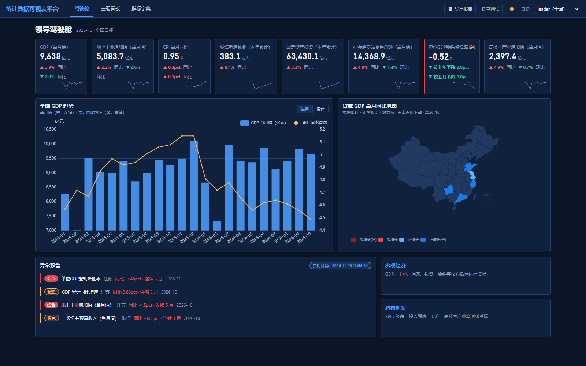
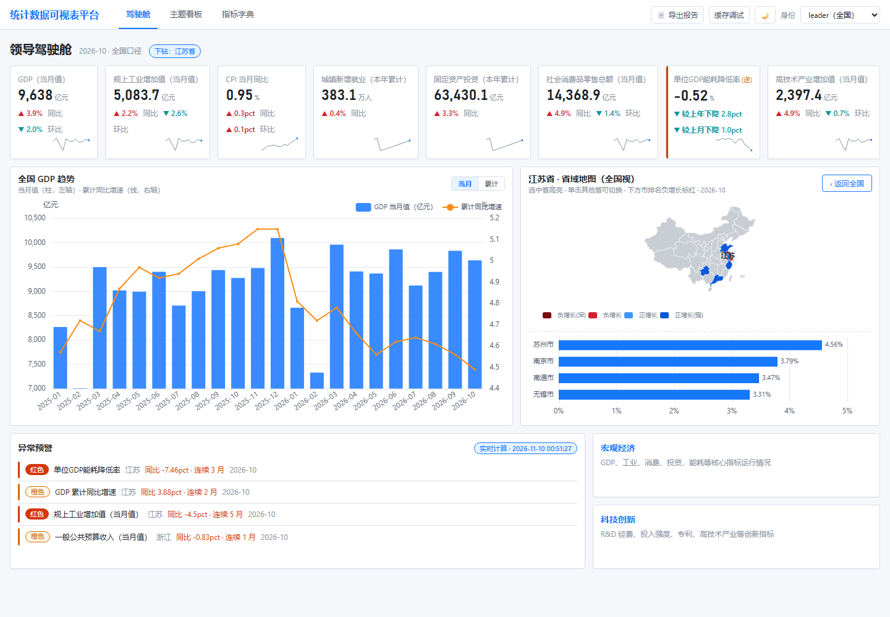
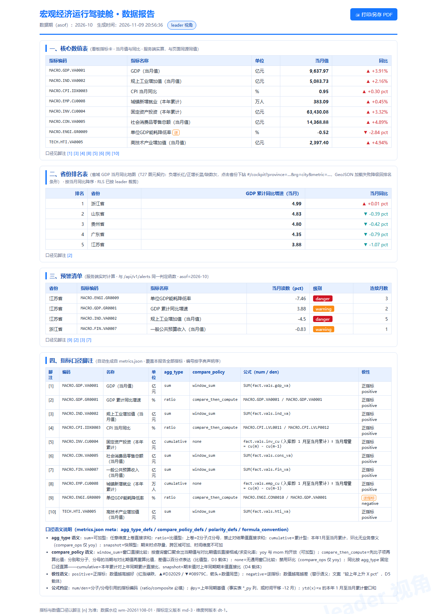
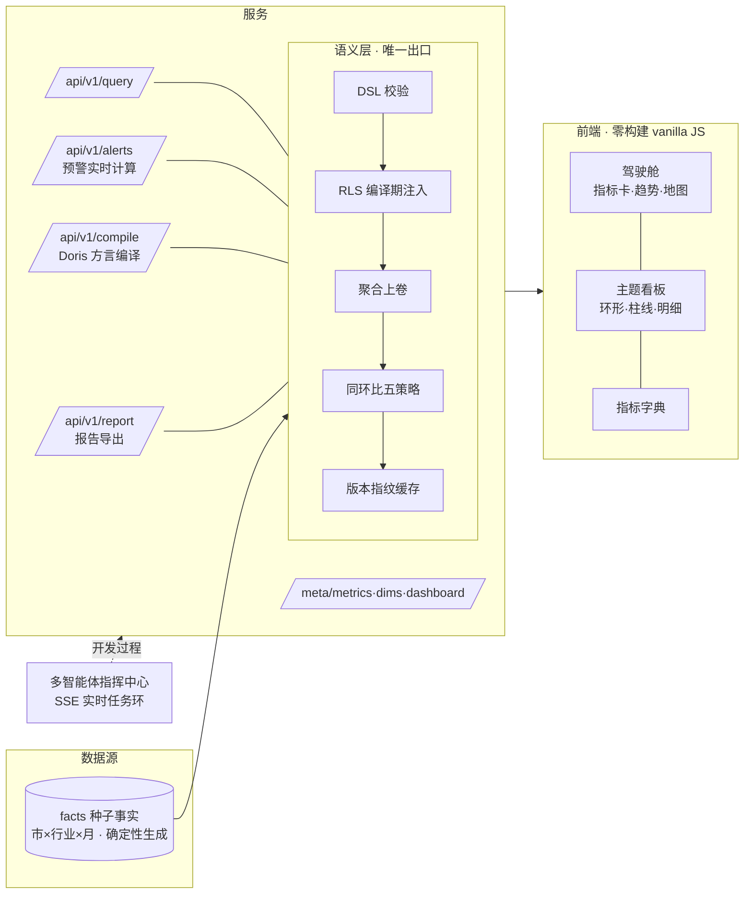

<div align="center">


<br>

[](https://github.com/topbat/statvista/actions/workflows/ci.yml)
[](https://github.com/topbat/statvista/releases)
[](LICENSE)
[](package.json)
[](mvp/server/tests.js)
[](#-贡献指南)

**指标先行的统计数据多维可视表平台**
*A metric-first multidimensional visual analytics platform for official statistics.*

[`在线体验`](https://topbat.github.io/statvista/demo/) · [`Releases`](https://github.com/topbat/statvista/releases) · [`完整设计方案`](docs/统计数据可视表平台设计方案.md) · [`讨论`](https://github.com/topbat/statvista/discussions)

</div>

---

## ✨ 简介

StatVista 是面向政务统计场景的**指标中台 + 多维可视分析平台**（开源技术验证原型）。它把分散在各主题、各地区、各行业的统计数据，统一成一套**口径唯一、可下钻、可联动、可指挥**的数据消费体验——从领导驾驶舱的全国总览，到一省一市的逐级下钻与跨图联动，再到可打印的口径报告。

核心设计围绕三条铁律：

> 1. **指标先行** — 每个指标有唯一编码（如 `MACRO.GDP.VA0001`）、口径公式、责任处室；图表只引用编码，禁止自带 SQL，从根上消灭"同名不同义"。
> 2. **一切皆 JSON** — 看板、大屏、图表、预警规则全是 JSON 配置：可版本管理、可跨节点下发、可一键回滚。
> 3. **语义层是唯一出口** — 所有查询经语义层编译为 SQL：RLS 行级权限编译期注入、脱敏在结果集执行、缓存键含版本指纹。前端与任何应用**永远不直连数据**。

---

## 📸 界面速览

| 领导驾驶舱（亮色 · 省域地图版） | 暗色驾驶舱（`?theme=dark`） |
|---|---|
|  |  |
| **地图下钻**（点击省份 → 市排名 · `drill:nav` 同协议） | **报告导出**（`/api/v1/report` · 口径脚注表 · 打印友好） |
|  |  |
| **主题看板**（行业构成联动 · 环形图过滤） | **指标字典**（口径/聚合/比较策略透明化） |
|  |  |
| **多智能体推进指挥中心**（本项目自身的开发过程管理，SSE 实时） | |
|  | |

---

## 🎯 项目背景

- **国家数据局** 2023 年 10 月挂牌，统筹数字中国、数据要素市场化与"**数据要素×**"三年行动（12 个领域）；
- **全国一体化政务大数据体系**要求"1+32+N"的库表联动与"一数一源"；
- 政务统计长期面临三大痛点：**口径不一**（同名指标在不同部门数值不同）、**指标烟囱**（各建各的可视化）、**取数慢**（临时取数靠人工跑 SQL）。

StatVista 用一个可运行的开源原型回答：**如果按"指标先行 + 语义层收口"重建统计可视化，体验应该是怎样的？**

---

## 💡 核心理念 → 技术映射

| 理念 | 落地机制 |
|------|---------|
| 指标先行 | 指标字典（16+ 指标）：唯一编码 / 口径公式 / `agg_type`（可加·比值·累计·快照） / `compare_policy`（同环比策略） / `polarity`（正逆指标） |
| 一切皆 JSON | 看板 `dashboards.json` 驱动页面渲染；预警规则服务端实时计算 |
| 语义层唯一出口 | `POST /api/v1/query`：DSL 校验 → RLS 编译期注入 → 内存聚合上卷 → 同环比五策略 → 版本指纹缓存 |
| 下钻零 JOIN | 事实表冗余层级列（prov/city/c1/c2），下钻=换 group by 列+等值过滤，亚秒可达 |
| 同环比不出错 | ratio 指标强制**先比分子分母再算比值**；累计指标禁环比；快照指标仅同比 |
| 联动有秩序 | `drill:nav` / `filter:click` 事件总线 + 冲突矩阵（同维 last-wins、全局筛选清空联动） |

---

## 🏗️ 架构



**技术栈**：零依赖 Node（语义层/服务，端口 3000）· 零构建 vanilla JS + 本地 ECharts（前端）· Apache ECharts · DOMPurify · DataV GeoAtlas 边界数据。生产化路线（React + antd + Apache Doris + 达梦）见[完整设计方案](docs/统计数据可视表平台设计方案.md)。

---

## 🚀 快速开始

```bash
git clone https://github.com/topbat/statvista.git
cd statvista
npm start          # 语义层服务 → http://127.0.0.1:3000
```

> 另有指挥中心：`npm run dashboard` → http://127.0.0.1:8787

**三个页面**：

| 页面 | URL | 看什么 |
|------|-----|--------|
| 领导驾驶舱 | `#/cockpit` | 8 指标卡（同环比箭头+迷你趋势）、GDP 趋势、**省域地图**（点击下钻）、异常预警（服务端实时计算） |
| 主题看板 | `#/theme/macro` | 行业构成环形图（**点击联动**：其余图表过滤+变暗+漏斗角标）、大类趋势、省市明细 |
| 指标字典 | `#/dict` | 每个指标的口径公式、`agg_type`/`compare_policy` 徽章、正逆指标说明 |

**体验动线（J1）**：全国总览 → 排名/地图发现江苏垫底 → 点击地图下钻 4 市 → 主题看板点制造业扇区联动过滤 → 右键落明细 → 页头「📄 导出报告」。右上角切换 **leader / prov-js / prov-gd** 三角色验证 RLS 数据裁剪。

**跑测试**：

```bash
npm test           # 95 条断言（聚合正确性/同环比策略/RLS/缓存/compile SQL 快照）
npm run test:demo  # 静态体验站 6 组黄金对账
npm run smoke      # 冒烟 25 条
```

---

## 🌐 在线体验

- **交互体验站**：<https://topbat.github.io/statvista/demo/> —— 零后端，语义层查询引擎移植进浏览器（与真实服务 6/6 组黄金对账）
- **公网入口**：<https://topbat.github.io/statvista/> —— 落地页含截图与导航
- **Releases**：<https://github.com/topbat/statvista/releases> —— 附体验站离线包 zip（解压后任意静态服务器即可运行）

---

## 📖 文档

| 文档 | 内容 |
|------|------|
| [设计方案](docs/统计数据可视表平台设计方案.md) | v1.0 总方案：需求/架构/机制/选型/路线图（7 个智能体调研+设计+红队评审产出） |
| [01-PRD](docs/mvp/01-PRD.md) | MVP 范围冻结、17 条可测 DoD、J1 演示脚本 |
| [03-DSL与API契约](docs/mvp/03-DSL与API契约.md) | 查询 DSL JSON Schema、错误码、缓存键公式、RLS 规则 |
| [09-v0.2契约冻结](docs/mvp/09-v0.2契约冻结.md) | 第 2 圈契约：预警/Doris/报告/地图/暗色 + 多智能体文件所有权铁律 |
| [10-测试报告-v02](docs/mvp/10-测试报告-v02.md) | v0.2 验收矩阵、J2 旅程记录、缺陷清单 |
| [全部文档](docs/mvp/) | 01~10 全套 PRD/设计/契约/测试报告 |

---

## 🗺️ Roadmap（长期路线图）

> 路线图是活文档，按圈迭代（每圈 = 一个版本 = 指挥中心任务环转一圈）；欢迎在 [Discussions](https://github.com/topbat/statvista/discussions) 提需求。

#### ✅ v0.1.x — 奠基（已完成）
- [x] 语义层 DSL → 聚合 → 同环比五策略 → 版本指纹缓存
- [x] 领导驾驶舱 / 主题看板 / 指标字典 三页面
- [x] RLS 三角色（leader / prov-js / prov-gd）
- [x] 49 条契约测试 + 安全加固（路径穿越五重防护 + CSP）+ 开源发布 + CI/CD 双流水线

#### ✅ v0.2.0 — 第 2 圈：可视化升级（已完成，当前）
- [x] **省域地图**：GeoJSON 渲染、点击下钻与条形同协议、负增长红/正增长蓝/缺数灰
- [x] **暗色大屏**：CSS 变量主题化 + 变量同步式 ECharts 换肤 + `?screen=tv` 投屏适配
- [x] **报告导出**：`/api/v1/report` 同源数值表 + 口径脚注表 + 打印友好
- [x] **预警服务端化**：`/api/v1/alerts` 实时计算（正逆指标语义、连续月数、垫底规则）
- [x] **Doris 编译器**：`/api/v1/compile` 方言 SQL + Executor 三通道（local/doris/shadow 双跑对账）
- [x] DOMPurify 白名单渲染（38 处注入点闭环）+ 断言 49→95

#### 🚧 v0.3 — 可信与可观测（规划中）
- [ ] 用户体系与会话鉴权（替代 query 传 role，生产安全前置）
- [ ] 脱敏矩阵增强：指标级 mask 规则引擎（`***`/取整/区间化）+ 分级 GB/T 43697 联动
- [ ] 缓存红队测试：口径修订 60 秒全端可见
- [ ] 真实 Doris 联调：`DORIS_SHADOW=1` 双跑对账开启，local/doris 逐指标对账
- [ ] 指标血缘与影响分析：口径修订 → 受影响看板清单

#### 🔭 v0.4 — 全域下钻与协同
- [ ] 市/县级 GeoJSON 下钻（全国 → 省 → 市 → 县四级）
- [ ] 自助分析工作台：指标×维度×过滤 自由交叉、保存个人看板、审批发布
- [ ] 预警订阅推送（站内/邮件/webhook）+ 阈值规则配置化
- [ ] 大屏轮播模式（多看板自动轮换 · 会议值守场景）

#### 🌌 v1.0 — 生产化（政务部署就绪）
- [ ] React 18 + antd 5 前端重构（语义层 DSL 契约不变）
- [ ] Apache Doris 生产接入（物化视图三级加速）+ 达梦 DM8 元数据库
- [ ] 主题域全量扩展（10 域：宏观经济→数据要素市场）
- [ ] 1+32 联邦架构：元数据集中下发、数据属地存储计算
- [ ] 等保三级合规包 + 信创适配矩阵（麒麟/鲲鹏/统信）

#### 🛸 v1.x+ — 生态
- [ ] 开放 API 与开发者门户（配额/文档/沙箱）
- [ ] NL2Query（自然语言→语义层词汇匹配，未注册指标拒答）
- [ ] 国际化 i18n + 无障碍适老化专项

---

## 🤝 贡献指南

欢迎任何形式的贡献：

1. Fork → 创建分支（`git checkout -b feat/your-feature`）→ 提交
2. **提交前必须**：`npm test`（95 条断言）与 `npm run test:demo` 全绿；涉及视觉改动请附截图
3. 提交信息遵循 Conventional Commits（`feat:` / `fix:` / `docs:` / `release:`）
4. 发起 Pull Request，CI（Node 18/20/22 矩阵）通过后由维护者审核

需求与建议请开 [Issue](https://github.com/topbat/statvista/issues) 或到 [Discussions](https://github.com/topbat/statvista/discussions) 讨论。

---

## 🙏 致谢

[Apache ECharts](https://echarts.apache.org/) · [DOMPurify](https://github.com/cure53/DOMPurify) · [DataV GeoAtlas](https://datav.aliyun.com/portal/school/atlas/area_selector)（行政边界）· [Apache Doris](https://doris.apache.org/)（方言目标）· [Keep a Changelog](https://keepachangelog.com/) · 以及本项目开发过程中使用的多智能体协作方法（详见[设计方案 §9](docs/统计数据可视表平台设计方案.md)）。

---

## 📄 许可证

[Apache License 2.0](LICENSE)

---

## ⚠️ 免责声明

本项目为**技术验证原型**：种子数据由确定性算法生成（含预埋演示异常），**不代表任何真实统计数据**；生产化目标架构（React + antd + Apache Doris + 达梦）与信创合规路径见完整设计方案。部署到生产前请完成等保测评与数据分级合规。
