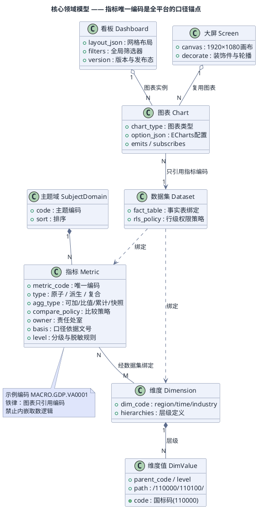
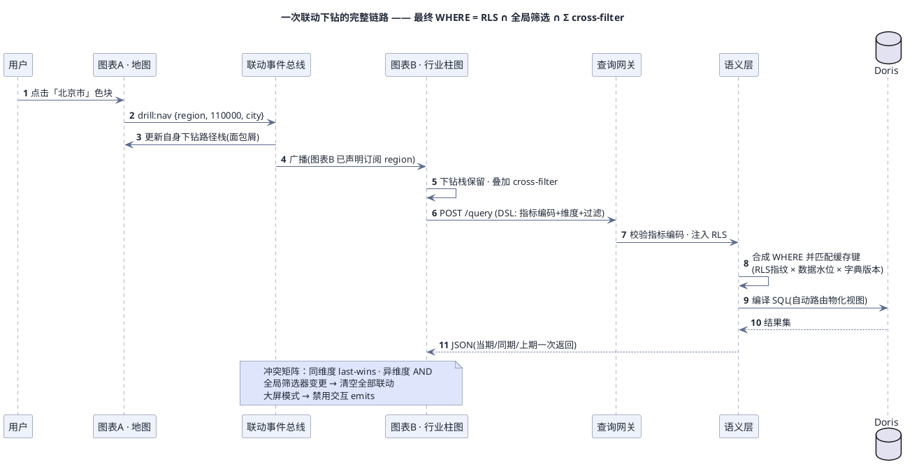
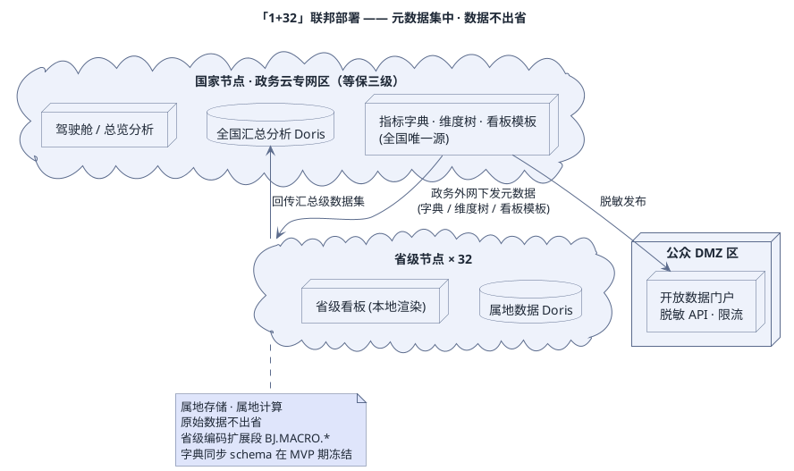

# 统计数据可视表平台 · 设计方案

> 版本 v1.1（docu.md 阅读版）· 2026-11-07 · 由 7 个智能体调研、设计、评审后定稿
> 本文档按 [docu.md](https://docu.md) 查看器规范编写：所有图形以文本形式内嵌，打开即实时渲染；文末附阅读与导出方法。

---

## 0. 三分钟看懂

一句话定位——面向国家数据局体系的"**指标中台 + 可视化分析平台**"：把分散在各主题、各地区、各行业的统计数据，统一成一套**口径唯一、可下钻、可联动、可指挥（大屏）**的数据消费体验。

<div style="max-width: 860px; box-sizing: border-box; position: relative;">
  <style>
    .sum-card { background: #eef2fb; border-left: 4px solid #2b66c4; color: #1f2937; padding: 18px 22px; }
    .sum-kicker { color: #2b66c4; font-size: 11px; font-weight: 700; letter-spacing: 0.12em; text-transform: uppercase; margin-bottom: 6px; }
    .sum-title { font-size: 20px; font-weight: 700; margin: 0 0 12px; }
    .sum-grid { display: grid; grid-template-columns: repeat(3, 1fr); gap: 10px; }
    .sum-item { background: #ffffff; border: 1px solid #5b6b8c; border-radius: 4px; padding: 10px 12px; }
    .sum-item b { display: block; font-size: 13px; margin-bottom: 4px; }
    .sum-item small { font-size: 11px; color: #676f7e; line-height: 1.4; display: block; }
  </style>
  <section class="sum-card">
    <div class="sum-kicker">三条核心思路</div>
    <div class="sum-title">先统一口径，再谈可视化</div>
    <div class="sum-grid">
      <div class="sum-item"><b>① 指标先行</b><small>每个指标有唯一编码、口径、责任人；图表只引用指标，不许自己写 SQL</small></div>
      <div class="sum-item"><b>② 一切皆 JSON</b><small>看板/大屏/图表全是 JSON 配置：可版本管理、可下发省级、可一键回滚</small></div>
      <div class="sum-item"><b>③ 语义层唯一出口</b><small>权限注入、脱敏执行、缓存管理全部收口在语义层，任何应用不许直连库</small></div>
    </div>
  </section>
</div>

**五个最重要的设计决策**：

| # | 决策点 | 结论 | 一句话理由 |
|---|--------|------|-----------|
| 1 | 自研 or 采购 | **语义层/指标字典自研，渲染层用开源，报表引擎评估采购** | 口径与下钻联动是核心资产，通用 BI 反而是包袱；但先用 6 周 bake-off 验证 |
| 2 | 下钻查询 | **事实表冗余层级列，下钻零 JOIN** | 下钻退化为"换 group by 列 + 等值过滤"，亚秒可达 |
| 3 | 国家-省级架构 | **元数据集中 + 数据联邦** | 数据不出省是政务底线，口径不失控是平台底线 |
| 4 | 联动机制 | **双轨制：全局筛选器单例 + 图表级事件总线** | 既保"改时间全板刷新"，又保"只联动 A 不联动 B" |
| 5 | 同环比 | **由指标元数据声明比较策略，语义层独占计算** | 比值指标先比子项再算比值，累计指标禁用环比——最容易错的地方 |

---

## 1. 需求理解：谁在用，用来干什么

**四类用户与核心场景**：

| 角色 | 典型场景 | 核心诉求 |
|------|---------|---------|
| **领导** | 驾驶舱总览 → 发现某省异常 → 下钻定位问题行业 | 零输入、纯点击、大屏可投屏 |
| **业务处室** | 主题专区 → 设时间/地区筛选 → 联动分析 → 导出报告 | 下钻到县/小类、PDF 带口径脚注 |
| **数据分析员** | 自助交叉查询（指标×维度×过滤）→ 保存看板 → 申请发布 | 灵活取数、API、审批发布 |
| **公众/开发者** | 浏览脱敏后的开放数据看板 | 免登录、可下载、合规免责 |

**主题域（10 个，对齐"数据要素×"与统计指标体系）**：宏观经济运行 / 人口就业与民生 / 科技创新 / 能源与绿色低碳 / 资源环境 / 农业农村 / 城市治理与公共安全 / 交通·商贸·文旅·卫健等行业主题 / 政务数据资源目录与公共数据登记 / 数据要素市场（授权运营、开发利用）。

**维度模型（整个平台的"坐标系"）**——总览、下钻、联动、分析、导出，就是在这套坐标系里自由移动：

```text
地区维度   全国 → 省 → 市 → 县        （GB/T 2260 行政区划码，约 3000 节点）
时间维度   年 → 季 → 月               （当期值 / 累计值两种口径）
行业维度   门类 → 大类 → 中类 → 小类   （GB/T 4754：20-97-473-1382 四级）
部门维度   司局 → 处室 / 省级数据部门
数据属性   开放级别（无条件/有条件/不予）× 分级（核心/重要/一般，GB/T 43697）
```

---

## 2. 核心概念：六个名词撑起整个平台

下图回答一个问题：**主题域、指标、维度、数据集、图表、看板、大屏之间是什么关系，口径锚点在哪**。



三个必须记住的字段设计：

- **指标注册强制声明** `agg_type`（可加 / 比值 / 累计 / 快照）与 `compare_policy`（先比子项再算比值 / 窗口求和 / 禁止比较）——这是同环比不出错的根。
- **维度值用扁平维表** + `parent_code` + 物化 `path`（如 `/110000/110100/`），子树过滤一条 `like` 搞定。
- **看板与大屏是同一份 JSON 的双主题渲染**——暗色大屏给"看"，亮色报告给"办"；带版本，可导入导出、跨节点下发、diff、回滚。

---

## 3. 总体架构：五层一横，语义层是唯一口径出口

下图回答：**平台分几层、每层跑什么、什么东西贯穿全部层级**。中间五层自上而下是依赖方向；两侧栏（支撑系统、安全合规）贯穿全部五层——它们不是第六层。

<div style="max-width: 1140px; box-sizing: border-box; position: relative;">
  <style>
    .arch-lw { background: #f8fafc; padding: 26px; color: #1f2937; }
    .arch-lw-title { margin: 0 0 6px; text-align: center; font-size: 27px; font-weight: 700; }
    .arch-lw-sub { margin: 0 0 18px; text-align: center; font-size: 13px; color: #676f7e; }
    .arch-lw-body { display: grid; grid-template-columns: 208px 1fr 208px; gap: 12px; align-items: stretch; }
    .arch-lw-wing { display: flex; flex-direction: column; padding: 12px; border-radius: 6px; background: #dfe5fb; border: 2px solid #334155; }
    .arch-lw-wing-head { font-size: 11px; font-weight: 700; letter-spacing: 0.13em; text-transform: uppercase; text-align: center; padding-bottom: 8px; margin-bottom: 10px; border-bottom: 1px solid #5b6b8c; }
    .arch-lw-wing-items { display: grid; gap: 7px; flex: 1; align-content: start; }
    .arch-lw-wing-item { padding: 8px 9px; background: #ffffff; border: 1px solid #5b6b8c; border-radius: 3px; font-size: 12px; font-weight: 600; line-height: 1.25; text-align: center; }
    .arch-lw-wing-item small { display: block; font-size: 9px; font-weight: 400; color: #676f7e; margin-top: 2px; }
    .arch-lw-wing-foot { margin-top: 10px; padding-top: 8px; border-top: 1px solid #5b6b8c; font-size: 10px; color: #676f7e; text-align: center; line-height: 1.3; }
    .arch-lw-core { display: grid; gap: 8px; align-content: stretch; }
    .arch-lw-layer { padding: 10px 12px; border-radius: 5px; border: 1px solid #5b6b8c; }
    .arch-lw-layer.fe { background: #d9e3f4; }
    .arch-lw-layer.svc { background: #d4eded; }
    .arch-lw-layer.sem { background: #e5defb; border: 2px solid #265aac; }
    .arch-lw-layer.data { background: #daeedd; }
    .arch-lw-layer.infra { background: #e7e1dc; }
    .arch-lw-layer-head { display: flex; align-items: baseline; gap: 8px; margin-bottom: 8px; }
    .arch-lw-layer-name { font-size: 11px; font-weight: 700; letter-spacing: 0.11em; text-transform: uppercase; }
    .arch-lw-layer-note { font-size: 10px; color: #1f2937; }
    .arch-lw-items { display: grid; gap: 6px; }
    .arch-lw-items.c3 { grid-template-columns: repeat(3, 1fr); }
    .arch-lw-items.c4 { grid-template-columns: repeat(4, 1fr); }
    .arch-lw-box { padding: 7px 8px; background: #ffffff; border: 1px solid #5b6b8c; border-radius: 3px; font-size: 11px; font-weight: 600; line-height: 1.25; text-align: center; }
    .arch-lw-box small { display: block; font-size: 9px; font-weight: 400; color: #676f7e; margin-top: 2px; }
    .arch-lw-box.entry { background: #ffffff; border: 2px solid #265aac; }
    .arch-lw-spans { margin-top: 12px; display: flex; align-items: center; gap: 10px; justify-content: center; font-size: 11px; color: #676f7e; }
    .arch-lw-spans i { display: block; flex: 0 0 90px; height: 0; border-top: 2px solid #334155; }
  </style>
  <section class="arch-lw">
    <h1 class="arch-lw-title">统计数据可视表平台 · 总体架构</h1>
    <p class="arch-lw-sub">中间五层自上而下是依赖方向；两侧栏贯穿全部五层，所以它们拉通整个高度</p>
    <div class="arch-lw-body">
      <aside class="arch-lw-wing">
        <div class="arch-lw-wing-head">支撑<br>系统</div>
        <div class="arch-lw-wing-items">
          <div class="arch-lw-wing-item">调度编排<small>DolphinScheduler · 任务依赖</small></div>
          <div class="arch-lw-wing-item">数据质量<small>Great Expectations · 断言阻断发布</small></div>
          <div class="arch-lw-wing-item">元数据与血缘<small>字典版本 · 影响分析</small></div>
          <div class="arch-lw-wing-item">监控告警<small>任务 · 查询延迟 · 数据水位</small></div>
          <div class="arch-lw-wing-item">审计日志<small>180 天留存 · 等保取证</small></div>
        </div>
        <div class="arch-lw-wing-foot">由平台组统一运维，<br>不在查询链路上。</div>
      </aside>
      <div class="arch-lw-core">
        <div class="arch-lw-layer fe">
          <div class="arch-lw-layer-head"><span class="arch-lw-layer-name">前端层</span><span class="arch-lw-layer-note">React 18 · antd 5 · ECharts 6 · wujie；只渲染 JSON，不含取数逻辑</span></div>
          <div class="arch-lw-items c3">
            <div class="arch-lw-box">门户与搜索</div>
            <div class="arch-lw-box">领导驾驶舱</div>
            <div class="arch-lw-box">主题看板</div>
            <div class="arch-lw-box">自助分析</div>
            <div class="arch-lw-box">数据大屏<small>1920×1080 · 轮播</small></div>
            <div class="arch-lw-box">开放门户<small>脱敏 · 免登录</small></div>
          </div>
        </div>
        <div class="arch-lw-layer svc">
          <div class="arch-lw-layer-head"><span class="arch-lw-layer-name">服务层</span><span class="arch-lw-layer-note">Spring Boot 3 · 编排语义层、裁剪与脱敏出口</span></div>
          <div class="arch-lw-items c4">
            <div class="arch-lw-box entry">查询网关<small>DSL 校验 · 限流</small></div>
            <div class="arch-lw-box">指标·维度服务</div>
            <div class="arch-lw-box">看板·大屏服务</div>
            <div class="arch-lw-box">导出中心<small>Puppeteer 截图/PDF</small></div>
            <div class="arch-lw-box">开放 API</div>
            <div class="arch-lw-box">受控取数<small>强制 RLS 视图 + 审计</small></div>
            <div class="arch-lw-box">统一鉴权<small>RBAC 到按钮级</small></div>
            <div class="arch-lw-box">审计日志</div>
          </div>
        </div>
        <div class="arch-lw-layer sem">
          <div class="arch-lw-layer-head"><span class="arch-lw-layer-name">语义层 ★唯一口径出口</span><span class="arch-lw-layer-note">指标+维度+筛选 → 唯一正确的 SQL</span></div>
          <div class="arch-lw-items c3">
            <div class="arch-lw-box">指标字典<small>编码·口径·责任人</small></div>
            <div class="arch-lw-box">维度层级树<small>国标码 · 物化 path</small></div>
            <div class="arch-lw-box">DSL 编译器<small>→ SQL 下推 Doris</small></div>
            <div class="arch-lw-box">RLS 注入<small>角色×数据集×WHERE</small></div>
            <div class="arch-lw-box">结果脱敏<small>*** / 取整 / 区间化</small></div>
            <div class="arch-lw-box">缓存<small>RLS指纹×水位×字典版本</small></div>
          </div>
        </div>
        <div class="arch-lw-layer data">
          <div class="arch-lw-layer-head"><span class="arch-lw-layer-name">数据层</span><span class="arch-lw-layer-note">星型建模 · 最细粒度：县 × 行业小类 × 月</span></div>
          <div class="arch-lw-items c4">
            <div class="arch-lw-box">ODS 贴源<small>原样落库 + 时间戳</small></div>
            <div class="arch-lw-box">DWD 明细<small>清洗 · 国标编码</small></div>
            <div class="arch-lw-box">DWS 汇总<small>物化视图自动上卷</small></div>
            <div class="arch-lw-box">ADS 宽表<small>限量预计算</small></div>
            <div class="arch-lw-box">DataX<small>T+1 批量</small></div>
            <div class="arch-lw-box">Flink CDC<small>增量同步</small></div>
            <div class="arch-lw-box">Apache Doris<small>x86 / ARM 双架构</small></div>
            <div class="arch-lw-box">Redis<small>热点结果缓存</small></div>
          </div>
        </div>
        <div class="arch-lw-layer infra">
          <div class="arch-lw-layer-head"><span class="arch-lw-layer-name">基础设施</span><span class="arch-lw-layer-note">一切运行于其上</span></div>
          <div class="arch-lw-items c4">
            <div class="arch-lw-box">政务云专网区</div>
            <div class="arch-lw-box">等保三级边界<small>防火墙·堡垒机·审计</small></div>
            <div class="arch-lw-box">信创栈<small>麒麟 · 鲲鹏 · 达梦</small></div>
            <div class="arch-lw-box">日志留存 180 天</div>
          </div>
        </div>
      </div>
      <aside class="arch-lw-wing">
        <div class="arch-lw-wing-head">安全合规<br>横切</div>
        <div class="arch-lw-wing-items">
          <div class="arch-lw-wing-item">统一鉴权 RBAC<small>角色 × 菜单 × 按钮</small></div>
          <div class="arch-lw-wing-item">数据权限 RLS<small>编译期注入 · 省/市天然隔离</small></div>
          <div class="arch-lw-wing-item">分类分级<small>GB/T 43697 · 核心/重要/一般</small></div>
          <div class="arch-lw-wing-item">动态脱敏<small>指标级规则 · 语义层执行</small></div>
          <div class="arch-lw-wing-item">地图合规<small>审图号 · CGCS2000</small></div>
        </div>
        <div class="arch-lw-wing-foot">全部在语义层与服务层强制执行，<br>前端永远不做安全。</div>
      </aside>
    </div>
    <div class="arch-lw-spans"><i></i><span>两侧栏贯穿全部五层 —— 它们不是第六层</span><i></i></div>
  </section>
</div>

**两条铁律**（架构的根基，红队评审后加固）：

1. **所有查询必经语义层**，禁止任何应用直连 Doris 自写 SQL——这是口径一致与 RLS 可靠的前提；用物理隔离（集群内只有语义层服务账号）+ 受控取数 API 留正门来保证不被绕过。
2. **指标唯一编码是全平台口径锚点**——图表只引用编码、禁止内嵌取数逻辑；看板/大屏本体是纯 JSON（含版本），可导入导出、跨节点下发、diff 回滚。

---

## 4. 数据链路：从源系统到看板，一站一站看

下图回答：**数据经过哪些站、每站干什么、性能靠什么达标**。四行数据源在顶部，五个阶段自左向右，虚线框是"出口/例外"而非流水线一站。

<div style="max-width: 1120px; box-sizing: border-box; position: relative;">
  <style>
    .pipe-dp { background: #f8fafc; padding: 26px; color: #1f2937; }
    .pipe-dp-title { margin: 0 0 6px; text-align: center; font-size: 26px; font-weight: 700; }
    .pipe-dp-sub { margin: 0 0 20px; text-align: center; font-size: 13px; color: #676f7e; }
    .pipe-dp-io { display: grid; grid-template-columns: repeat(4, 1fr); gap: 8px; margin-bottom: 14px; }
    .pipe-dp-source { padding: 9px 10px; text-align: center; font-size: 12px; font-weight: 600; background: #ffffff; border: 1px dashed #5b6b8c; border-radius: 4px; }
    .pipe-dp-row { display: flex; align-items: stretch; gap: 0; }
    .pipe-dp-stage { flex: 1; padding: 12px; border-radius: 6px; background: #eef2fb; border: 1px solid #5b6b8c; }
    .pipe-dp-stage.landing { background: #d9e3f4; border-color: #265aac; }
    .pipe-dp-stage.serve { background: #dfe5fb; border-color: #265aac; }
    .pipe-dp-num { display: inline-flex; align-items: center; justify-content: center; width: 20px; height: 20px; border-radius: 50%; background: #2b66c4; color: #ffffff; font-size: 11px; font-weight: 700; margin-right: 7px; }
    .pipe-dp-head { font-size: 11px; font-weight: 700; letter-spacing: 0.12em; text-transform: uppercase; color: #1f2937; margin-bottom: 10px; }
    .pipe-dp-item { padding: 7px 9px; margin-bottom: 6px; background: #ffffff; border: 1px solid #5b6b8c; border-radius: 3px; font-size: 12px; line-height: 1.3; }
    .pipe-dp-item:last-child { margin-bottom: 0; }
    .pipe-dp-item small { display: block; font-size: 10px; color: #676f7e; margin-top: 2px; }
    .pipe-dp-item.dead { border-style: dashed; color: #676f7e; }
    .pipe-dp-arrow { display: flex; align-items: center; justify-content: center; width: 34px; flex-shrink: 0; font-size: 20px; color: #676f7e; }
    .pipe-dp-sla { display: grid; grid-template-columns: repeat(4, 1fr); gap: 8px; margin-top: 14px; }
    .pipe-dp-kpi { padding: 10px; text-align: center; background: #ffffff; border: 1px solid #5b6b8c; border-radius: 4px; }
    .pipe-dp-kpi b { display: block; font-size: 19px; font-weight: 700; }
    .pipe-dp-kpi span { font-size: 10px; color: #676f7e; text-transform: uppercase; letter-spacing: 0.08em; }
    .pipe-dp-note { margin-top: 12px; font-size: 11px; color: #676f7e; text-align: center; }
  </style>
  <section class="pipe-dp">
    <h1 class="pipe-dp-title">数据链路：ODS → DWD → DWS → ADS → 语义服务</h1>
    <p class="pipe-dp-sub">五个阶段一个方向；查询时语义层优先命中 DWS 物化视图，直下明细才扫 DWD</p>
    <div class="pipe-dp-io">
      <div class="pipe-dp-source">统计联网直报</div>
      <div class="pipe-dp-source">名录库与普查</div>
      <div class="pipe-dp-source">部门共享交换</div>
      <div class="pipe-dp-source">公共数据登记平台</div>
    </div>
    <div class="pipe-dp-row">
      <div class="pipe-dp-stage landing">
        <div class="pipe-dp-head"><span class="pipe-dp-num">1</span>ODS 贴源</div>
        <div class="pipe-dp-item">DataX 批量<small>T+1 常态通道</small></div>
        <div class="pipe-dp-item">Flink CDC<small>增量变更</small></div>
        <div class="pipe-dp-item">原样落库<small>分区 + 采集时间戳</small></div>
        <div class="pipe-dp-item dead">全量历史保留<small>重算与审计回溯</small></div>
      </div>
      <div class="pipe-dp-arrow">→</div>
      <div class="pipe-dp-stage">
        <div class="pipe-dp-head"><span class="pipe-dp-num">2</span>DWD 明细</div>
        <div class="pipe-dp-item">清洗与标准化<small>统一计量单位</small></div>
        <div class="pipe-dp-item">国标编码<small>GB/T 2260 · GB/T 4754</small></div>
        <div class="pipe-dp-item">冗余层级列<small>prov/city/county · c1–c4</small></div>
        <div class="pipe-dp-item">最细粒度<small>县 × 行业小类 × 月</small></div>
      </div>
      <div class="pipe-dp-arrow">→</div>
      <div class="pipe-dp-stage">
        <div class="pipe-dp-head"><span class="pipe-dp-num">3</span>DWS 汇总</div>
        <div class="pipe-dp-item">Doris 物化视图<small>按 统计域×粒度 预聚合</small></div>
        <div class="pipe-dp-item">自动上卷改写<small>优化器路由，无需改 SQL</small></div>
        <div class="pipe-dp-item">覆盖 90% 亚秒查询<small>省市/门类等粗粒度</small></div>
      </div>
      <div class="pipe-dp-arrow">→</div>
      <div class="pipe-dp-stage">
        <div class="pipe-dp-head"><span class="pipe-dp-num">4</span>ADS 应用</div>
        <div class="pipe-dp-item">高频看板宽表<small>一行一图，限量建</small></div>
        <div class="pipe-dp-item dead">口径旁路红线<small>能被物化视图覆盖就不建</small></div>
      </div>
      <div class="pipe-dp-arrow">→</div>
      <div class="pipe-dp-stage serve">
        <div class="pipe-dp-head"><span class="pipe-dp-num">5</span>语义服务</div>
        <div class="pipe-dp-item">DSL 编译<small>指标编码 → SQL</small></div>
        <div class="pipe-dp-item">RLS 注入 + 脱敏<small>编译期 · 结果集</small></div>
        <div class="pipe-dp-item">Redis 热点缓存<small>版本指纹失效</small></div>
        <div class="pipe-dp-item">REST API<small>声明式 JSON DSL</small></div>
      </div>
    </div>
    <div class="pipe-dp-sla">
      <div class="pipe-dp-kpi"><b>T+1</b><span>常态数据时效</span></div>
      <div class="pipe-dp-kpi"><b>≤ 2s</b><span>明细查询 P95（千万行·50并发）</span></div>
      <div class="pipe-dp-kpi"><b>≤ 1.5s</b><span>下钻查询 P95</span></div>
      <div class="pipe-dp-kpi"><b>毫秒级</b><span>热点缓存命中</span></div>
    </div>
    <p class="pipe-dp-note">虚线框是出口或红线，不是流水线的一站；指标体系按 OneData：派生指标 = 原子指标 + 业务限定 + 统计周期 + 统计粒度。</p>
  </section>
</div>

**加速三层递进**：① 库内物化视图自动路由（覆盖 90% 亚秒需求）→ ② Redis 热点缓存（键含版本指纹，口径修订/区划调整/新批次入库三类事件主动失效，TTL 兜底）→ ③ ADS 宽表（限量，"能被物化视图覆盖就不建"）。

---

## 5. 关键机制设计（硬核部分）

### 5.1 下钻：从全国到县、从门类到小类

- **存储**：事实表直接冗余各级编码列（`region_prov/city/county`、`ind_c1~c4`），下钻**零 JOIN**——从省钻到市只是 group by 列换一下、WHERE 加一个等值条件；代价是区划年度调整时重刷维表，调度固化，可接受。
- **前端状态**：**每个图表独立持有下钻状态**（A 图钻在行业 2 级、B 图钻在地区 3 级互不干扰）。三种入口（点图元 / 面包屑 / 维度树侧栏）发**同一事件**；切换下钻维度时原维度**降级保留为过滤器**而非丢弃；URL 存短编码终态，刷新/分享可还原，浏览器前进后退映射下钻历史。
- **地图下钻**：全国→省→市→县，GeoJSON 按区划码懒加载；县级为最深层，点击改右侧抽屉展示。
- **性能**：DWS 层 Doris 物化视图自动上卷改写路由，90% 下钻查询亚秒返回。

### 5.2 联动：cross-filter 事件总线

下图回答：**点击一下地图，数据从哪走到哪、权限和缓存在哪一层起作用**。



**冲突矩阵（写死，不留歧义）**：

```text
最终 WHERE = RLS ∩ 全局筛选 ∩ Σ cross-filter
同维度多事件   → last-wins（后到覆盖）
异维度事件     → 交集（AND）
下钻 × 联动    → 下钻栈保留，仅重算数据
全局筛选器变更 → 清空全部图表的 cross-filter 栈
cf 与下钻状态  → 一并压缩进 URL
大屏模式       → 禁用交互 emits，只保留数据订阅与轮播（防演示误触）
```

**视觉反馈**：被过滤图表变暗 35% + 漏斗角标（hover 显示来源图表）；全局/图表筛选**分色胶囊**并列，可单个删、可一键清除；所有变化 300–500ms 过渡，禁止跳变。

### 5.3 同环比：最容易出错的地方，用元数据治

| 指标类型 | 错误做法 | 正确做法 |
|---------|---------|---------|
| 可加型（GDP 总量） | — | 当期 vs 同期直接比 |
| **比值型（增速、占比）** | 对结果值直接比 ❌ | **先比分子分母、再算比值**（compare_then_compute） |
| **累计型（1-6 月累计）** | 累计值环比 ❌ | **禁用环比入口**，只提供同比；UI 联动隐藏无意义操作 |

同环比由语义层独占，与下钻维度正交（下钻换维度时口径不变）；一次 SQL 多子查询（当期/同期/上期）算完。展示用红涨绿跌（▲#D32029 / ▼#08979C），铁律"颜色只表方向，必须同显箭头+数值"；逆指标（能耗强度、失业率）按 polarity 切换文案。

### 5.4 权限与脱敏：编译期注入，前端永远不做安全

- **RLS = 角色×数据集×WHERE 谓词**，语义层编译时注入；用户绑机构节点自动生成 `path like '本节点/%'`——省看全省、市看本市天然成立；RLS 尽量收敛为"角色桶"而非按人（否则缓存命中率塌陷）。
- **脱敏规则挂指标元数据**，语义层在结果集执行（低权限返回 `***`，半敏感取整/区间化）。
- **缓存安全**：缓存键 = `RLS指纹 × 数据水位线 × 维度树版本 × 指标定义版本`；验收含"改口径 60 秒内全端可见"的红队测试。
- **防绕过**：Doris 网络物理隔离（集群内只有语义层账号）+ "受控取数 API"留正门（任意 SQL 强制包 RLS 视图 + 全量审计）+ 存量报表 SQL→DSL 半自动迁移工具。

### 5.5 查询 DSL（前端唯一取数方式）

```json
POST /api/v1/query
{
  "metrics":    ["MACRO.GDP.VA0001", "MACRO.GDP.GR0001"],
  "dimensions": [{ "dim": "region", "granularity": "city" }],
  "filters":    [{ "dim": "region", "op": "descendantOf", "value": "110000" }],
  "time":       { "grain": "month", "range": ["2026-01","2026-10"], "compare": ["yoy"] },
  "limit":      50
}
```

指标只允许引用注册编码（禁止裸 SQL）；过滤器为 and/or/not 递归树；时间显式声明粒度以便路由到对应物化视图；所有聚合图表右键可 **drill-to-detail** 落明细兜底。

---

## 6. 技术选型定论表

| 层次 | 选型 | 理由 | 备选 |
|------|------|------|------|
| OLAP | **Apache Doris** | 物化视图自动上卷、政务案例最多、x86/ARM 双架构 | StarRocks（PoC 对比） |
| 元数据库 | **达梦 DM8** | 信创名录 | openGauss |
| 语义层 | **自研 DSL（MVP 冻结：原子+一层派生、单事实表）**，评估 Cube.js 内核 | 口径/层级/RLS 是核心资产 | Cube.js 二开 |
| 集成/调度 | **DataX + Flink CDC / DolphinScheduler** | 政务 T+1 为主、国产可视化调度 | Airflow |
| 质量 | **Great Expectations** | 断言失败阻断发布 | — |
| 前端 | **React 18 + TS + antd 5 + Zustand** | 中后台生态最全 | Vue 3（团队栈优先） |
| 图表 | **ECharts 6** | Apache-2.0、全图表内置、大数据量优化 | AntV G2 |
| 地图 | **ECharts GeoJSON 下钻 + 天地图底图** | 内网可用；**审图号强制、坐标统一 CGCS2000** | AntV L7 |
| 布局/配置 | **react-grid-layout + JSON Schema/Formily** | 低代码本质是生产/消费 JSON | gridstack |
| 微前端/导出 | **wujie / Puppeteer 服务端渲染** | 隔离彻底；导出带口径脚注+水印 | qiankun / html2canvas |
| 服务端/缓存 | **Spring Boot 3 (Java 17) / Redis** | 信创全兼容 | — |

复杂中式报表（套打、填报）立项时与帆软做 **6 周 bake-off** 再定采购与否。

---

## 7. 部署与信创、1+32 联邦

下图回答：**国家节点与省级节点各存什么、什么下行什么上行、公众在哪一侧**。



**信创替代矩阵**：CPU 鲲鹏/飞腾/海光 ｜ OS 麒麟 V10/统信 UOS ｜ 中间件东方通 ｜ 元数据库达梦 DM8 ｜ OLAP Doris——全栈无境外闭源运行时，前端库全 MIT/Apache 自托管。**等保三级**：防火墙 + 堡垒机 + 数据库审计 + 日志留存 180 天；公众开放数据独立 DMZ。

---

## 8. 路线图：四段推进（红队修正后的现实工期）

下图回答：**先做什么后做什么、每一段的里程碑是什么**。详细范围与验收标准见表格。

```infographic
infographic sequence-roadmap-vertical-simple
theme
  colorPrimary #2b66c4
  palette
    - #2b66c4
    - #2f9e44
    - #f3a33c
    - #d1242f
    - #7048e8
    - #0f9b9b
    - #c16f8a
    - #7c5a3d
data
  title 分期路线图（总长 24 个月）
  desc 预备 PoC → MVP 内网试运行 → 一期全量上线 → 二期生态开放
  sequences
    - label 第0月 · 预备
      desc 信创三件 PoC · 等保备案启动 · 6 周 bake-off
      icon mdi/flask
    - label 第1–5月 · MVP
      desc 冻结范围 DSL · 2 主题域 · 下钻与 RLS · 黄金 SQL 用例
      icon mdi/rocket-launch
    - label 第6–11月 · 一期
      desc 10 主题域 · 联动 · 大屏 · 等保测评 · 2 省试点
      icon mdi/chart-line
    - label 第12–24月 · 二期
      desc 自助分析 · 开放 API · 1+32 产品化 · 指标血缘
      icon mdi/api
```

**第 0 月（硬性前置）**：信创三件 PoC（麒麟/统信自带浏览器兼容矩阵、达梦方言差异清单、**Doris 鲲鹏基准压测**——数亿行、50 并发）；等保三级定级备案启动（流程 3–6 个月，不能等）；6 周 bake-off：3 个代表性看板"自研 vs 帆软采购"各做一遍，锁定自研边界。

**MVP（第 1–5 月）内网试运行（豁免等保门禁）**：指标字典只读 + DSL（冻结范围）+ 2 主题域 50 指标 + 地区/时间两维 + 看板 JSON 渲染 + 单维下钻 + RLS 骨架 + 单部门管理闭环 + 冻结联邦 schema + "黄金 SQL 用例集"（每指标 1 条人工核准基准 SQL，编译器唯一验收物）。
**DoD**：与源系统对账 100% 一致；明细查询 P95 ≤ 2s（千万行 @ 50 并发）；RLS 越权用例 100% 拦截；下钻 P95 ≤ 1.5s；黄金用例通过率 100%。

**一期（第 6–11 月）全量上线**：10 主题域 500 指标 + 行业四级下钻 + 联动总线 + 大屏模块（暗色+轮播）+ 天地图/审图号 + 导出中心 + 脱敏分级 + 跨部门口径审核（统计局仲裁）+ 1–2 省人工试点。
**DoD**：等保三级测评报告 + 整改闭环；脱敏抽检 100% 通过；缓存红队测试通过（改口径 60 秒全端可见）；试点省实际运行。

**二期（第 12–24 月）生态开放**：自助分析（拖拽建图+取数申请+审批发布）+ 开放数据 API 门户 + 1+32 联邦产品化（元数据自动下发）+ 指标血缘与影响分析 + NL2Query（**只做"自然语言→已注册指标匹配"**：未命中拒答并提示注册，敏感级默认拒绝，执行计划全量留痕）。
**DoD**：≥20 省级节点接入；开放 API ≥100 指标；血缘覆盖全部派生/复合指标。

**止损触发器（写进立项文档，触发即切换采购，不再走审批）**：

| 触发条件 | 时点 |
|---------|------|
| 黄金用例通过率 < 90% 或 下钻+同环比 P95 超标 | MVP 第 2 月末 |
| 语义层核心人员流失 ≥ 1 人 | 任意时点 |
| 等保测评因语义层审计不通过 | 一期 |
| 省级试点无法运行自研栈 | 一期尾 |

---

## 9. 产品体验要点

### 9.1 领导旅程：零输入、纯点击的异常溯源

下图回答：**领导从打开驾驶舱到定位问题，动几次手**——答案是一次点击都不用输入。

```infographic
infographic sequence-snake-steps-simple
theme
  colorPrimary #2b66c4
  palette
    - #2b66c4
    - #2f9e44
    - #f3a33c
    - #d1242f
    - #7048e8
    - #0f9b9b
    - #c16f8a
    - #7c5a3d
data
  title 领导驾驶舱 · 异常溯源五步（J1）
  desc 零输入纯点击：从全国总览一路定位到负增长的行业小类
  sequences
    - label 全国总览
      desc 8 张指标卡 · 同环比
      icon mdi/view-dashboard
    - label 发现异常
      desc 排名垫底省份标红
      icon mdi/alert-circle-outline
    - label 地图下钻
      desc 点击进入该省 · 面包屑更新
      icon mdi/map-marker
    - label 行业联动
      desc 点环形图制造业 · 其余图表联动
      icon mdi/chart-donut
    - label 明细定位
      desc 右键落明细 · 锁定负增长小类
      icon mdi/magnify
```

### 9.2 交互规范（摘要）

- **下钻三入口**（点图元 / 面包屑 / 维度树侧栏）发同一事件；叶子节点点击转为"查看明细"；当前路径唯一并同步 URL（可收藏分享）。
- **联动反馈**：源图元描边高亮；被过滤图表变暗 35% + 漏斗角标；分色胶囊可单个删、可一键清除。
- **三态统一**：加载中骨架屏（超 3s 加文案）；空数据区分"暂无数据"与"当前筛选下无数据"（附清除按钮）；无权限显示锁图标 + 申请权限入口（不暴露数据是否存在）。
- **大屏 vs 报告**：同一看板 JSON 双主题渲染——大屏（暗色、scale 等比、30s 轮播、禁交互 emits）给"看"；报告（亮色、全交互、PDF 带口径脚注+水印）给"办"。
- **政务红线**：地图仅用标准地图底图并永久标注审图号，坐标统一 CGCS2000；适老化开关（字号+30%、去渐变）；对比度 ≥ 4.5:1。

### 9.3 领导驾驶舱版式

下图回答：**驾驶舱一屏怎么分区**——顶部 20% 指标卡、中部 55% 趋势+地图、底部 25% 排名+预警。

<div style="max-width: 1040px; box-sizing: border-box; position: relative;">
  <style>
    .cb-wrap { background: #f8fafc; padding: 22px; color: #1f2937; }
    .cb-title { margin: 0 0 4px; text-align: center; font-size: 20px; font-weight: 700; }
    .cb-sub { margin: 0 0 14px; text-align: center; font-size: 12px; color: #676f7e; }
    .cb-meta { display: flex; justify-content: space-between; font-size: 10px; color: #676f7e; margin-bottom: 8px; }
    .cb-kpis { display: grid; grid-template-columns: repeat(8, 1fr); gap: 6px; margin-bottom: 8px; }
    .cb-kpi { background: #ffffff; border: 1px solid #5b6b8c; border-radius: 3px; padding: 7px 4px; text-align: center; font-size: 10px; font-weight: 700; }
    .cb-kpi small { display: block; font-weight: 400; font-size: 8px; color: #676f7e; margin-top: 2px; }
    .cb-kpi.alert { border-left: 3px solid #d1242f; }
    .cb-mid { display: grid; grid-template-columns: 6fr 4fr; gap: 8px; margin-bottom: 8px; }
    .cb-panel { background: #ffffff; border: 1px solid #5b6b8c; border-radius: 4px; padding: 8px 10px; }
    .cb-panel h4 { margin: 0 0 6px; font-size: 10px; font-weight: 700; color: #1f2937; letter-spacing: 0.06em; }
    .cb-panel h4 span { float: right; color: #676f7e; font-weight: 400; }
    .cb-plot { border: 1px dashed #5b6b8c; border-radius: 3px; height: 92px; margin-top: 4px; display: flex; align-items: center; justify-content: center; font-size: 10px; color: #676f7e; background: #f8fafc; }
    .cb-bot { display: grid; grid-template-columns: 1fr 1fr; gap: 8px; }
    .cb-row { display: flex; justify-content: space-between; font-size: 10px; padding: 4px 2px; border-bottom: 1px solid #eef2fb; }
    .cb-row:last-child { border-bottom: none; }
    .cb-chip { font-size: 8px; padding: 1px 5px; border-radius: 8px; border: 1px solid; }
    .cb-chip.r { background: #f7d8da; border-color: #b82029; color: #b82029; }
    .cb-chip.o { background: #fdeedc; border-color: #8a5a00; color: #8a5a00; }
    .cb-chip.g { background: #dfe5fb; border-color: #265aac; color: #1f2937; }
    .cb-legend { margin-top: 6px; font-size: 9px; color: #676f7e; text-align: center; }
  </style>
  <section class="cb-wrap">
    <h1 class="cb-title">领导驾驶舱 · 一屏版式</h1>
    <p class="cb-sub">顶部 20% 指标卡 · 中部 55% 趋势与地图 · 底部 25% 排名与预警</p>
    <div class="cb-meta"><span>数据截止：2026-10（月度）</span><span>大屏模式 →</span></div>
    <div class="cb-kpis">
      <div class="cb-kpi">GDP<small>同比 +5.2%</small></div>
      <div class="cb-kpi">规上工业<small>同比 +6.1%</small></div>
      <div class="cb-kpi">CPI<small>同比 +0.4%</small></div>
      <div class="cb-kpi">就业<small>同比 +1.2%</small></div>
      <div class="cb-kpi">投资<small>同比 +3.8%</small></div>
      <div class="cb-kpi">消费<small>同比 +4.5%</small></div>
      <div class="cb-kpi alert">能耗强度<small>同比 -2.1% 逆指标</small></div>
      <div class="cb-kpi">外贸<small>同比 +2.9%</small></div>
    </div>
    <div class="cb-mid">
      <div class="cb-panel">
        <h4>核心指标趋势 <span>[月 | 季 | 年] 页签 · 增速右轴</span></h4>
        <div class="cb-plot">趋势折线 + 当期/同期对比区</div>
      </div>
      <div class="cb-panel">
        <h4>全国地图 <span>choropleth · 点击下钻</span></h4>
        <div class="cb-plot">色阶地图 + 图例 + 审图号</div>
      </div>
    </div>
    <div class="cb-bot">
      <div class="cb-panel">
        <h4>省份排名 <span>TOP / BOTTOM 页签 · 点行即下钻</span></h4>
        <div class="cb-row"><span>1. 江苏省</span><span>+6.4%</span></div>
        <div class="cb-row"><span>2. 广东省</span><span>+6.0%</span></div>
        <div class="cb-row"><span>… 30. 某省</span><span>+1.1%</span></div>
        <div class="cb-row"><span>31. 某省（垫底标红）</span><span>+0.3%</span></div>
      </div>
      <div class="cb-panel">
        <h4>预警滚动 <span>指标 · 地区 · 偏离幅度 · 时间</span></h4>
        <div class="cb-row"><span>工业增速偏离 · 某省</span><span class="cb-chip r">红 · -3.2pct</span></div>
        <div class="cb-row"><span>投资放缓 · 某市</span><span class="cb-chip o">橙 · -1.8pct</span></div>
        <div class="cb-row"><span>能耗反弹 · 某省</span><span class="cb-chip o">橙 · +1.1pct</span></div>
        <div class="cb-row"><span>更新提醒 · 全国</span><span class="cb-chip g">提示</span></div>
      </div>
    </div>
    <div class="cb-legend">示意线框（非实数据）：异常卡片红色左竖条；逆指标按 polarity 切换文案与警示色。</div>
  </section>
</div>

---

## 10. 团队与治理

**约 20 人核心 + 省市驻场 4–6 人滚动**：架构 1 / 语义层后端 2（**强制结对防单点**）/ 服务层 3 / 前端 5 / 数据工程 3 / DBA+信创运维 2（+1 Doris 专职或商业支持）/ 测试 2（含渗透）/ UI 1 / PM 1 + 外聘 Headless BI 顾问带教 2–3 个月。

**口径治理**：指标分两类——

- **法定指标**（GDP 等统计局口径）：锁定口径 + 依据文号，**只读引用不可改**，数据局无权"审核"；
- **部门管理指标**：自主定义，注册强制填 Owner 处室、口径依据文号、数据来源责任人；
- 会签 5 个工作日超时自动升级局领导并请统计局仲裁；MVP 只做单一部门内闭环，跨部门流程放一期。

**需要决策人拍板的 5 个问题**：

1. 自研边界与止损预算是否锁进立项文档？
2. 口径主权（法定/部门指标边界、统计局仲裁）是否局层面发文确认？
3. 等保备案第 1 月启动、MVP 豁免门禁、Doris 鲲鹏压测不过关时接受 x86 过渡吗？
4. 1+32 字典同步 schema 在 MVP 冻结 + 一期 1–2 省人工试点？
5. 语义层 2 人强制结对 + 外聘顾问预算 + Doris 专职增编是否批准？

---

## 11. 多智能体讨论纪要

| 智能体 | 职责 | 关键产出 |
|--------|------|---------|
| 领域调研员 | 国家数据局/公共数据/合规 | 10 主题域、维度模型、4 类用户、合规红线 |
| 竞品调研员 | 6 开源 + 5 商业 BI | 8 条可借鉴模式；"自研语义层+复用渲染"结论 |
| 前端调研员 | 图表/地图/布局/联动/大屏 | React+ECharts 6 技术栈；审图号/CGCS2000 合规 |
| 数据架构调研员 | OLAP/建模/语义层/加速 | Doris+星型+三级加速；DSL 设计要点 |
| 总架构师 | 综合出架构稿 | 分层架构、领域模型、下钻/联动机制 |
| 产品设计师 | 交互与旅程 | IA、5 旅程、交互规范、驾驶舱版式 |
| 红队评审 | 批判挑战 | 17 项修正（全部吸收进本稿）、5 个拍板问题 |

**关键争论与最终裁决**：自研 vs 采购 → 分层混合 + 6 周 bake-off + 止损线（不赌）；全局单栈 vs per-chart 下钻状态 → per-chart（红队胜）；同环比通用后处理 → 指标元数据声明比较策略（红队胜）；MVP 3 个月 → 5 个月（等保与信创 PoC 是硬约束）；NL2SQL → 降级为 NL→词汇匹配（合规优先）。

---

## 附：如何阅读与导出本文档

- **阅读**：安装 [docu.md Markdown Viewer](https://docu.md)（Chrome/Edge/Firefox 扩展、Obsidian 或 VS Code 插件），把本文件拖进浏览器或双击打开——所有图形实时渲染，34 种主题可切换。
- **导出**（需 Node 18+ 与 Chrome/Chromium）：`npx @markdown-viewer/documd 统计数据可视表平台设计方案-docu.md 输出.docx`（同样支持 `.pdf` / `.epub` / `.html`）。
- **图形即文本**：每张图都是文档里的一段源码（PlantUML / Infographic / HTML），改文字就是改图；注意 HTML 图形内部不能有空行。

*附：主要参考——国家数据局官网、《数据要素×三年行动计划》、国办《全国一体化政务大数据体系建设指南》、GB/T 4754-2017、GB/T 43697-2024、国家统计局数据平台、上海/贵州数据开放平台；Superset/DataEase/Metabase/FineBI 官方文档；Apache Doris/StarRocks/Cube.js 官方文档。*
